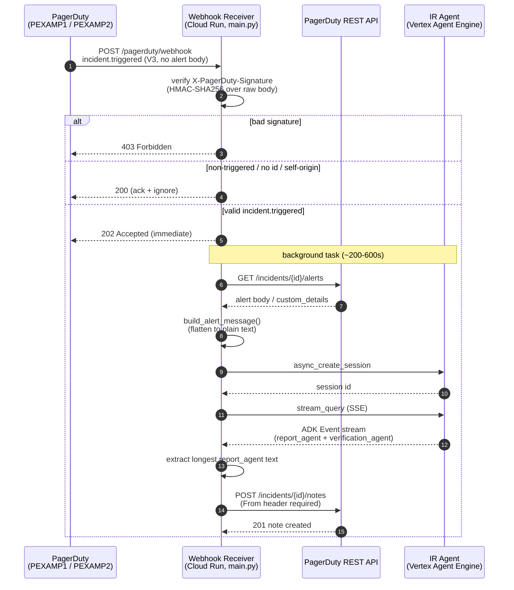
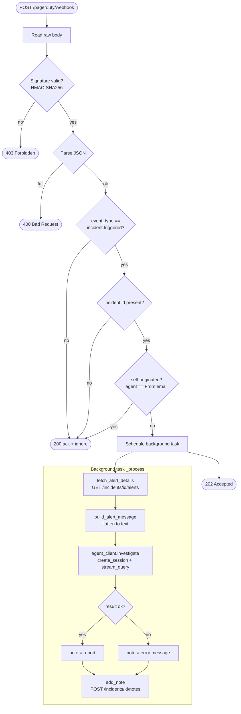

# PagerDuty → Incident Response Agent Integration

Wires PagerDuty SRE alerts to the deployed Incident Response (IR) Agent and returns the
synthesized triage back onto the originating incident as a note. Source lives in
`<workspace>/incident-response-agent/integrations/pagerduty/`.

Implements ADO story
[#276333](https://dev.azure.com/acme/Infrastructure/_workitems/edit/276333)
(per `integrations/pagerduty/README.md`).

---

## Overview

A **separate Cloud Run service** (the "receiver") accepts PagerDuty V3 webhooks, runs the
alert through the IR Agent on Vertex AI Agent Engine, and posts the report back as an
incident note. The agent itself stays on Agent Engine — this service only *calls* it
(`README.md` lines 17-19).

| Aspect | Value | Source |
|---|---|---|
| Trigger event | `incident.triggered` only | `main.py:28` (`_HANDLED = {"incident.triggered"}`) |
| PD services | `PEXAMP1` (Platform - Datadog - High), `PEXAMP2` (Platform - Datadog - Low) | `README.md:28-29` |
| Escalation policy | `PESCAL1` | `README.md:24` |
| Transport | PD V3 `webhook_subscription` → HTTPS POST `/pagerduty/webhook` | `main.py:63` |
| Security boundary | HMAC-SHA256 `X-PagerDuty-Signature` over raw body | `pagerduty_client.py:28-35` |
| Agent | Vertex AI Agent Engine `reasoningEngines/1000000000000000002` | `agent_client.py:27-31` |
| Response back to PD | Note on the **same** incident via `POST /incidents/{id}/notes` | `pagerduty_client.py:84-105` |
| Why async | Agent runs ~200-600s (streamQuery ~600s deadline); PD needs a fast 2xx | `agent_client.py:33-34`, `main.py:5-6` |

---

## End-to-end flow

1. A PagerDuty service (`PEXAMP1` or `PEXAMP2`, on escalation policy `PESCAL1`) fires
   `incident.triggered`.
2. The PD V3 `webhook_subscription` POSTs the event to `POST /pagerduty/webhook` on the
   Cloud Run receiver (`main.py:63-64`).
3. The receiver reads the **raw** body and verifies `X-PagerDuty-Signature` (HMAC-SHA256
   over the raw bytes). On mismatch it returns **403** and stops (`main.py:65-70`,
   `pagerduty_client.py:28-35`).
4. It parses JSON and filters: non-`incident.triggered` events, events with no incident
   id, and self-originated events are ACKed with **200** and ignored
   (`main.py:72-91`).
5. For a valid `incident.triggered`, it schedules a **background task** and immediately
   returns **202** — the long investigation never runs on the request path
   (`main.py:93-95`).
6. In the background (`_process`, `main.py:36-60`):
   - Fetch alert details via `GET /incidents/{id}/alerts`, because the V3 payload omits
     the alert body (`pagerduty_client.py:38-63`).
   - Flatten incident metadata + alert details into a single plain-text message
     (`pagerduty_client.py:66-81`).
   - Invoke the IR agent: `async_create_session` then `stream_query` (SSE); extract the
     synthesized report (longest `report_agent` text) plus verification
     (`agent_client.py:100-129`, `46-97`).
   - Post the report back as a note on the **same** incident via
     `POST /incidents/{id}/notes` with the required `From` header
     (`pagerduty_client.py:84-105`).

---

## Sequence diagram

---

## Receiver request-handling flowchart

---

## Components

| File | Responsibility |
|---|---|
| `integrations/pagerduty/main.py` | FastAPI receiver. `POST /pagerduty/webhook`: verify signature → filter → return 202 → background `_process` (fetch → invoke → note). Also `GET /healthz`. |
| `integrations/pagerduty/agent_client.py` | Invokes the Vertex Agent Engine. ADC token, `async_create_session` (with cold-start retry), `stream_query` (SSE), and `_extract_report` (longest `report_agent` / `verification_agent` text). |
| `integrations/pagerduty/pagerduty_client.py` | PagerDuty REST helpers: `verify_signature`, `fetch_alert_details`, `build_alert_message`, `add_note`, and env accessors for the three secrets. |
| `integrations/pagerduty/test_pagerduty_client.py` | Unit tests for signature verification + message building (per `README.md:98`). |
| `integrations/pagerduty/deploy.ps1` / `Dockerfile` / `requirements.txt` | Cloud Run deploy artifacts (per `README.md:99`). |

---

## Setup & secrets

### Secrets (GCP Secret Manager, project `aiops-dev-project`)

| Secret | Env var (in code) | Purpose |
|---|---|---|
| `pagerduty-webhook-signing-secret` | `PD_WEBHOOK_SECRET` | Verify `X-PagerDuty-Signature` (`pagerduty_client.py:110-111`) |
| `pagerduty-rest-api-token` | `PD_REST_API_TOKEN` | REST token with incident **write** scope, for alert fetch + notes (`pagerduty_client.py:114-118`) |
| `pagerduty-from-email` | `PD_FROM_EMAIL` | Real PD user email required in the `From` header (`pagerduty_client.py:121-122`, default `ir-agent@acme.example`) |

### Runtime service account

`ir-pd-receiver-sa@aiops-dev-project.iam.gserviceaccount.com` (per `README.md:46`):
- `roles/aiplatform.user` on `aiops-dev-project` — to call `reasoningEngines` `streamQuery`
  (auth uses ADC, `agent_client.py:8-11`, `39-43`).
- `secretmanager.secretAccessor` on the three secrets above.

### Optional env overrides (`agent_client.py`)

| Env var | Default | Purpose |
|---|---|---|
| `IR_AGENT_ENGINE_URL` | `reasoningEngines/1000000000000000002` | Engine REST endpoint (changes on redeploy) |
| `IR_AGENT_STREAM_TIMEOUT` | `900` (s) | Client timeout, kept above the ~600s streamQuery deadline |
| `IR_AGENT_USER_ID` | `pagerduty-webhook@acme.example` | Session user id |

### Create the webhook subscription

`POST https://api.pagerduty.com/webhook_subscriptions` with
`"events": ["incident.triggered"]` and a `service_reference` filter for `PEXAMP1`, repeated
for `PEXAMP2` (or a `team_reference` for the whole SRE team). **Capture the `secret` from
the response** and store it as `pagerduty-webhook-signing-secret` (per `README.md:60-81`).

---

## Security & loop prevention

- **Signature verification is the security boundary.** The endpoint may be public; every
  request is HMAC-SHA256 verified over the **raw** body before any work happens; a bad or
  missing signature returns 403 (`main.py:67-70`, `pagerduty_client.py:28-35`). The header
  is `v1=<hex>[,v1=<hex>...]` — multiple candidates during secret rotation are each
  compared with `hmac.compare_digest` (`pagerduty_client.py:29-35`).
- **No feedback loop, by design** (`main.py:10-12`):
  - Subscribes to `incident.triggered` only — adding a note does not re-trigger
    (`main.py:28`).
  - The receiver only **adds** notes; it never creates or annotate-triggers incidents
    (`pagerduty_client.py:84-105`).
  - Defense-in-depth: events whose `agent.summary` equals the configured `From` email are
    skipped as self-originated (`main.py:87-91`).
- **Note cap.** PagerDuty notes are capped at 65,535 single-byte chars; reports are
  truncated to 60,000 with a `…[truncated]` marker (`pagerduty_client.py:23-25`, `87-88`).
- **Errors never reach the request path.** `_process` swallows all exceptions and logs
  them; if the agent fails, an "triage unavailable" note is posted instead
  (`main.py:52-60`).

---

## Notes / caveats

- The V3 webhook payload does **not** include the triggering alert body — only incident
  metadata — so `fetch_alert_details` pulls `GET /incidents/{id}/alerts` (first 5 alerts,
  truncated to 8,000 chars) to get the diagnostic `details`/`cef_details` the agent needs
  (`pagerduty_client.py:38-63`).
- The report is extracted as the **longest** text part authored by `report_agent` across
  the SSE stream (partials may stream); verification is the longest `verification_agent`
  text (`agent_client.py:70-97`).
- Session creation retries transient cold-instance failures up to 5 times
  (`agent_client.py:46-67`).
