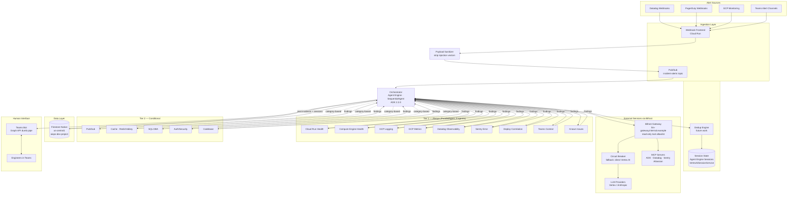
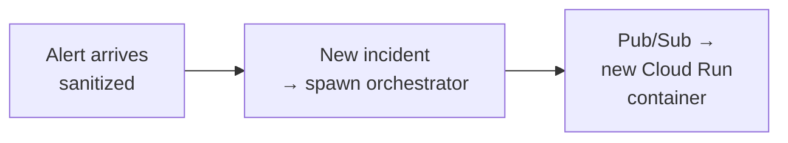
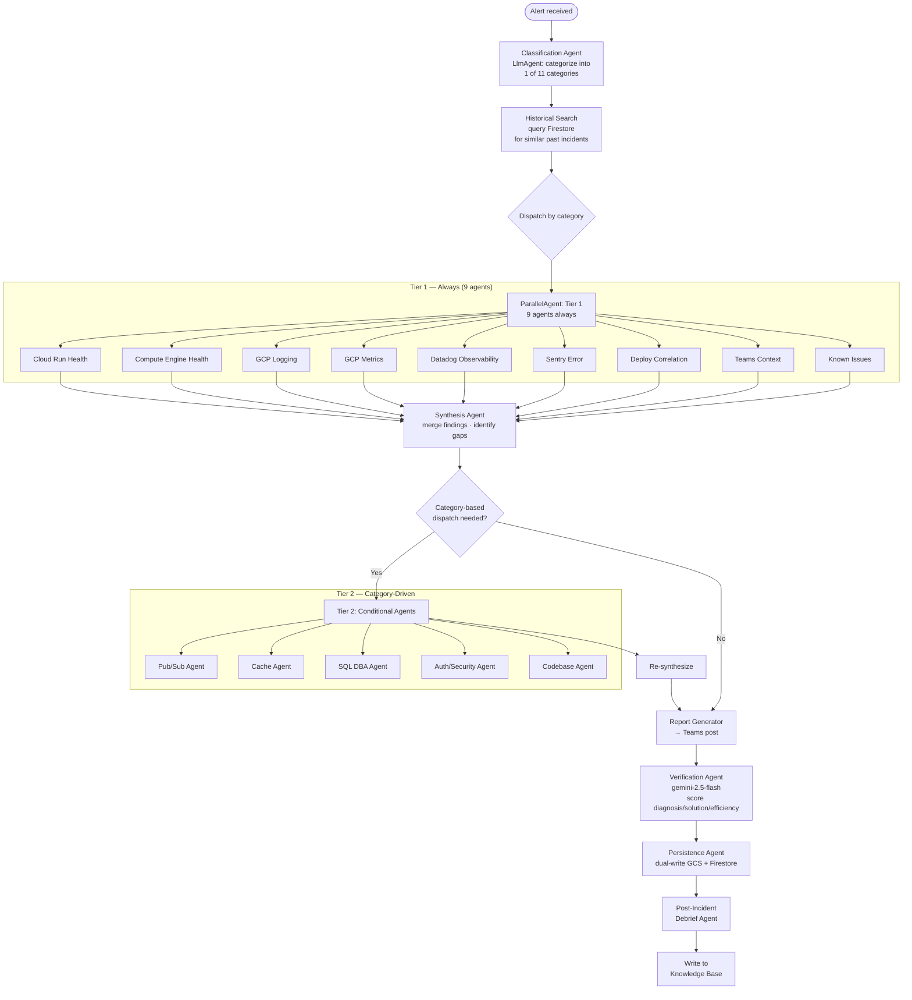
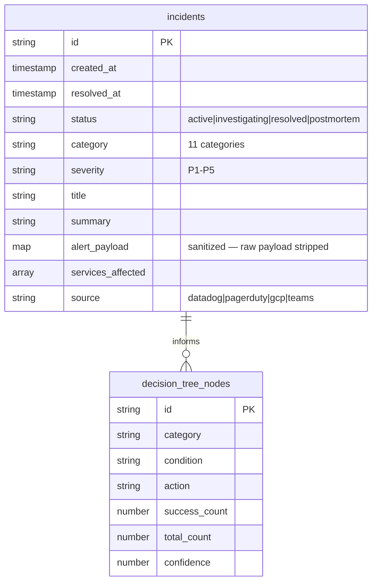

# Incident Response Agent Platform — Project Plan

## Context

The existing `incidents:incident-response` Claude Code skill (985-line SKILL.md) is a prompt-based orchestrator that guides a human through incident triage. It works but has fundamental limitations: it requires a human operator to invoke it, runs only inside Claude Code sessions, can't receive alerts programmatically, and retains no institutional memory between incidents. This project converts it into a standalone agentic platform that receives webhooks, triages autonomously, and interacts with engineers via Teams — building a learning system that gets smarter with every incident.

**Trigger:** SRE team handles dozens to low-hundreds of alerts per week, with investigation sessions lasting up to hours. Current manual triage is slow, inconsistent, and loses knowledge when incidents close.

**Outcome:** A Cloud Run-hosted, ADK-powered incident response platform that automatically triages alerts, dispatches parallel investigation agents, posts findings to Teams, and builds a searchable knowledge base of past incidents.

---

## Refined Prompt

> Build an agentic incident response platform using Google ADK 2.2.0 on Vertex AI Agent Engine that:
>
> 1. **Receives alerts** via webhooks from Datadog, PagerDuty, and GCP Monitoring, plus manual triggers from Teams alert channels
> 2. **Classifies and deduplicates** using a two-pass system: fast time+service window check, then semantic similarity against active investigations
> 3. **Dispatches 16 tightly-scoped, deterministic investigation agents** (9 Tier 1 + 5 Tier 2 + orchestration pipeline) via hub-and-spoke architecture with event-driven state relay for near-real-time collaboration
> 4. **Interacts with engineers** through a Teams "dumb pipe" bot (Graph API, not Bot Framework) — the orchestrator controls all posting logic; the bot is a stateless tool
> 5. **Stores and learns** from every incident via Firestore, building decision trees informed by past incidents and conducting post-incident debriefs. Semantic similarity search planned for Phase 2 via Vertex AI Vector Search
> 6. **Routes through Bifrost** for LLM inference (semantic cache, virtual keys, budget enforcement, MCP tool aggregation)
>
> Phase 1 is read-only and human-in-the-loop. Future phases add response agents, role-based agent layers, and efficiency optimizations.

---

## Architecture

### System Overview



### Alert Flow & Deduplication

Dedup engine is planned for future work. Current implementation spawns a new investigation for each alert.



### Investigation Workflow (ADK Agent Graph)



---

## Agent Roster — 16 Deterministic Investigation Agents

Design principle: **agent scope = investigation question, not tool boundary.** Each agent has a numbered checklist it executes in order. No open-ended exploration.

### Tier 1 — Always Dispatched (ParallelAgent)

#### 1. Cloud Run Health Agent
**Question:** "Is the affected service's compute infrastructure healthy?"

| Step | Action | Tool |
|------|--------|------|
| 1 | Get Cloud Run service status (revision, traffic split) | `gcloud run services describe` |
| 2 | Check instance count vs min/max, scaling events | `gcloud run services describe` |
| 3 | Check startup/liveness probe health | `gcloud run services describe` |
| 4 | Get recent OOM kills, container restarts | GCP Cloud Logging (severity=ERROR, resource.type=cloud_run_revision) |

**Output:** `{status, instance_count, recent_restarts, oom_events, confidence}`

#### 2. Compute Engine Health Agent
**Question:** "Are VMs and instance groups healthy?"

| Step | Action | Tool |
|------|--------|------|
| 1 | List VM instances for affected project, check status (RUNNING/TERMINATED/STOPPED) | `gcloud compute instances list` |
| 2 | Check instance group health (managed/unmanaged, target size vs actual) | `gcloud compute instance-groups managed describe` |
| 3 | Get persistent disk status and snapshots | `gcloud compute disks list` |
| 4 | Check serial port output for boot errors | `gcloud compute instances get-serial-port-output` |
| 5 | Check VM CPU/memory/disk utilization metrics | GCP Monitoring time series |

**Output:** `{vm_status[], instance_group_health, disk_status[], boot_errors[], resource_utilization, confidence}`

#### 3. GCP Logging Agent
**Question:** "What errors and warnings appeared around alert time?"

| Step | Action | Tool |
|------|--------|------|
| 1 | Query ERROR/WARNING logs ±15 min of alert time | `gcp-observability:list_log_entries` |
| 2 | Aggregate top 10 errors by type/frequency | LLM analysis of step 1 |
| 3 | Extract stack traces from application logs | `gcp-observability:list_log_entries` (filter: resource.type) |
| 4 | Check audit logs for admin actions in window | `gcp-observability:list_log_entries` (filter: protoPayload) |

**Output:** `{top_errors[], stack_traces[], admin_actions[], confidence}`

#### 4. GCP Metrics Agent
**Question:** "What do GCP alert policies and metric trends show?"

| Step | Action | Tool |
|------|--------|------|
| 1 | List alert policies related to affected service | `gcp-observability:list_alert_policies` |
| 2 | Get active alert incidents | `gcp-observability:list_alerts` |
| 3 | Query time series for affected metrics (±1h) | `gcp-observability:list_time_series` |
| 4 | Classify trend: growing / stable / declining / spike | LLM analysis of step 3 |
| 5 | Compare related metrics across all regions | `gcp-observability:list_time_series` (per region) |

**Output:** `{active_alerts[], metric_trends[], trend_classification, cross_region_comparison, confidence}`

#### 5. Datadog Observability Agent
**Question:** "What do dashboards, monitors, and APM traces show?"

| Step | Action | Tool |
|------|--------|------|
| 1 | Pull environment-specific SRE dashboard (Prod: `aaa-111-bbb`, Sandbox: `ggg-444-hhh`, Test: `eee-333-fff`, Ephemeral: `iii-555-jjj`) | Datadog MCP: `get_dashboard` |
| 2 | Based on dashboard signals, pull domain dashboard (SQL: `ccc-222-ddd`, PubSub: `ooo-888-ppp`, Redis: `sss-010-ttt`, Valkey: `kkk-666-lll`, LB: `qqq-999-rrr`) | Datadog MCP: `get_dashboard` |
| 3 | List monitors in alert/warn state only (never pull all 316) | Datadog MCP: `get_monitors` (status filter) |
| 4 | Query targeted APM traces with precise filters (limit 10-20) | Datadog MCP: `list_traces` |

**Service name mapping (critical):** WebCore = `service:acme.example`, FileService = `service:files.acme.example`, Pricing = `service:app.catalog.example`

**Output:** `{dashboard_signals[], active_monitors[], trace_samples[], confidence}`

#### 6. Sentry Error Agent
**Question:** "Are there new or spiking errors in Sentry for the affected service?"

| Step | Action | Tool |
|------|--------|------|
| 1 | List recent issues for the affected Sentry project (sorted by frequency) | Sentry MCP: `list_issues` |
| 2 | Get error details for top issues (stack trace, breadcrumbs, tags) | Sentry MCP: `get_issue` |
| 3 | Check release correlation — did errors start with a specific release? | Sentry MCP: `list_releases` / issue first_seen vs release date |
| 4 | Get error rate trend (is it spiking, new, or pre-existing?) | Sentry MCP: issue `count` + `firstSeen` analysis |
| 5 | Extract affected users/endpoints from error metadata | Sentry MCP: `get_issue` tags |

**Sentry project mapping** (from the infrastructure-context observability domain): one project per service per language runtime. Event volume is high enough that the agent must scope every query by project and time window rather than listing issues.

**Output:** `{top_errors[], new_since_deploy, error_rate_trend, affected_endpoints[], release_correlation, confidence}`

#### 7. Deploy Correlation Agent
**Question:** "Was there a recent deployment that could explain this?"

| Step | Action | Tool |
|------|--------|------|
| 1 | Get recent builds for affected service pipeline | ADO MCP: `pipelines_get_builds` |
| 2 | List PRs merged today | ADO MCP: `repo_list_pull_requests` (status=completed) |
| 3 | Get recent Octopus deployments | Octopus MCP: `list_deployments` |
| 4 | For each PR: validate it's NEW to this deploy (not pre-existing) | `git merge-base --is-ancestor` — only flag PRs that return FALSE |
| 5 | Review file changes in flagged PRs for affected code paths | ADO MCP: `repo_get_pull_request_by_id` |

**Non-negotiable rule:** Deploy correlation ≠ causation. Prove with: (a) new code changed affected queries AND (b) errors only on new revision.

**Output:** `{recent_deploys[], new_prs[], file_changes[], deploy_correlation_evidence, confidence}`

#### 8. Teams Context Agent
**Question:** "Is there relevant context in Teams channels about this issue?"

| Step | Action | Tool |
|------|--------|------|
| 1 | List recent threads in alert channel | Teams MCP: `list_threads` |
| 2 | Read threads mentioning affected service/error | Teams MCP: `read_thread` |
| 3 | Extract engineer observations and timeline | LLM analysis of thread content |

**Non-negotiable rule:** Teams context is INPUT, never EVIDENCE. Every observation must be verified with metrics before attributing cause.

**Output:** `{relevant_threads[], engineer_observations[], context_only_flag=true, confidence}`

#### 9. Known Issues Agent
**Question:** "Is there an existing ADO bug that matches this issue?"

| Step | Action | Tool |
|------|--------|------|
| 1 | Search ADO bugs (<7 days) by endpoint name | ADO MCP: `search_workitem` (type:Bug, recent) |
| 2 | Search by error type / service name | ADO MCP: `search_workitem` |
| 3 | Search by keywords: "slow", "timeout", "performance", "query" | ADO MCP: `search_workitem` |
| 4 | Return top 5 matching work items | Rank by relevance |

**Non-negotiable rule:** A bug filed yesterday IS the answer. 30-second ADO search saves 30 minutes of investigation.

**Output:** `{matching_bugs[], best_match_id, best_match_confidence, confidence}`

### Tier 2 — Category-Driven Dispatch

Dispatched by the Synthesis Agent based on alert category and Tier 1 gaps.

| Agent | Dispatch Trigger (categories) |
|-------|-------------------------------|
| Pub/Sub Agent | `pubsub-messaging`, or Tier 1 finds backlog signals |
| Cache Agent | `cloud-infrastructure` with cache signals, or Tier 1 finds cache errors |
| SQL DBA Agent | `sql-database`, `performance` with DB signals, or Tier 1 finds blocking/high CPU |
| Auth/Security Agent | `auth-security`, or Tier 1 finds auth failures/WAF events |
| Codebase Agent | Any category where Tier 1 cannot identify root cause (last resort, token-heavy) |

#### 10. Pub/Sub Agent
**Question:** "Is there a Pub/Sub backlog, dead letter, or consumer failure?"

| Step | Action | Tool |
|------|--------|------|
| 1 | Describe subscription (ack deadline, push config, dead letter policy) | `gcloud pubsub subscriptions describe` |
| 2 | Check message backlog size and oldest unacked message age | GCP Monitoring: `pubsub.googleapis.com/subscription/num_undelivered_messages` |
| 3 | Check consumer pull/push rates and error rates | GCP Monitoring: time series |
| 4 | Trace the PUBLISHER — what's generating the messages? | GCP Logging: publish activity |
| 5 | Check IAM permissions on subscription | `gcloud pubsub subscriptions get-iam-policy` |

**Non-negotiable rule:** For backlogs, always trace the publisher. Consumer failure is the symptom; unexpected publish volume is often the cause.

**Output:** `{backlog_size, oldest_unacked_age, consumer_rate, publisher_activity, iam_issues[], confidence}`

#### 11. Cache Agent (Redis/Valkey)
**Question:** "Is the cache layer healthy — memory, connections, evictions?"

| Step | Action | Tool |
|------|--------|------|
| 1 | Check Redis/Valkey memory usage vs max | Datadog MCP: `query_metrics` (redis.mem.used, redis.mem.maxmemory) |
| 2 | Check connected/blocked client counts | Datadog MCP: `query_metrics` (redis.clients.connected, redis.clients.blocked) |
| 3 | Check eviction rate and key count | Datadog MCP: `query_metrics` (redis.keys.evicted, redis.keys.count) |
| 4 | Check cache hit/miss ratio trend | Datadog MCP: `query_metrics` |
| 5 | Check GCP Memorystore status | `gcloud redis instances describe` |

**Output:** `{memory_pct, connected_clients, blocked_clients, eviction_rate, hit_miss_ratio, confidence}`

#### 12. SQL DBA Agent
**Question:** "Is SQL Server the bottleneck — blocking, CPU, slow queries?"

10-step deterministic checklist:

| Step | Action | Tool |
|------|--------|------|
| 1 | Active connections snapshot by host | Datadog MCP: `query_metrics` (sqlserver.stats.connections by host) |
| 2 | CPU by host | Datadog MCP: `query_metrics` (system.cpu.user, system.cpu.system by host:sqlprod*) |
| 3 | Blocking chains — flag if >15 sessions blocked | Datadog MCP: `query_metrics` (sqlserver.stats.lock_waits) |
| 4 | Long transactions (>60s) | Datadog MCP: `list_traces` (service:acmedb duration:>60s) |
| 5 | Batch requests & compilations | Datadog MCP: `query_metrics` (sqlserver.stats.batch_requests, sql_compilations) |
| 6 | Top CPU queries — rank by `total_hits × avg_duration` | Datadog MCP: `query_metrics` (trace.sql_server.query.hits by resource_name) |
| 7 | Top P95 latency queries — rank by max duration | Datadog MCP: `query_metrics` (trace.sql_server.query.duration.95p by resource_name) |
| 8 | SQL traces >10s — extract full SQL statement | Datadog MCP: `list_traces` (service:acmedb duration:>10s, limit 20) |
| 9 | Ben/Tom Performance Dashboard | Datadog MCP: `get_dashboard` (`mmm-777-nnn`) |
| 10 | Query structure red flags | LLM analysis of SQL from step 8: missing JOINs, implicit conversions, UNION vs UNION ALL, N+1, cross-shard fan-out |

**Non-negotiable rules:** Follow BOTH outlier types (duration AND volume). Rank by `total_hits × avg_duration` alongside max duration. Never dismiss worst outlier as "pre-existing."

**Output:** `{connection_count, cpu_by_host[], blocking_chain_count, long_transactions[], top_cpu_queries[], top_p95_queries[], slow_traces[], red_flags[], confidence}`

#### 13. Auth/Security Agent
**Question:** "Is there an auth failure, DDoS, WAF event, or certificate issue?"

| Step | Action | Tool |
|------|--------|------|
| 1 | Check Cloud Armor WAF logs for blocked requests, attack patterns | GCP Logging: `list_log_entries` (resource.type=http_load_balancer, severity>=WARNING) |
| 2 | Check Auth0 error rates (if auth-related alert) | Datadog MCP: `query_metrics` (auth0 metrics) |
| 3 | Check certificate expiry for affected domains | `gcloud compute ssl-certificates describe` |
| 4 | Check JA3 fingerprints for DDoS patterns | GCP Logging: WAF logs with JA3 |
| 5 | Review Cloud Armor policy rules for the affected service | `gcloud compute security-policies describe` |

**Output:** `{waf_blocked_requests, auth_error_rate, cert_status, ddos_indicators[], policy_rules[], confidence}`

#### 14. Codebase Agent (Tier 2 — last resort)
Unchanged from existing skill. Only dispatched when Tier 1 + other Tier 2 agents cannot identify root cause. Token-heavy — uses file system search across the local repo checkouts.

---

## Tool Inventory via Bifrost

All investigation agents access tools through Bifrost MCP gateway (`llm-gateway.internal.example/mcp`).

**Read-only enforcement (red team fix #3):** Each MCP server uses an explicit `tools_to_execute` allowlist restricted to read-only operations. The previous `["*"]` wildcard is replaced with per-server allowlists. This is the gateway-level enforcement of Phase 1 read-only policy; agent prompts provide the second layer.

| MCP Server | Allowed Tools (Phase 1) | Used By Agents | Auth |
|------------|-------------------------|----------------|------|
| Datadog (`datadog_token`) | `get_dashboard`, `get_monitors`, `list_traces`, `query_metrics`, `search_monitors` (5 of 86) | Datadog Observability, SQL DBA, Cache, Auth/Security | Service account headers |
| Azure DevOps (`azure_devops_token`) | `search_workitem`, `wit_get_work_items_batch_by_ids`, `repo_list_pull_requests`, `repo_get_pull_request_by_id`, `pipelines_get_builds` (5 of 47) | Deploy Correlation, Known Issues | VPC-only (internal) |
| Sentry (`sentry_token`) | `list_issues`, `get_issue`, `list_releases`, `get_project` (4 of ~20) | Sentry Error | **Service account token** (internal auth token, not per-user OAuth) |
| Atlassian (`atlassian_token`) | `search_confluence`, `get_page` (2 of ~29) | Orchestrator (runbook lookup) | Service account headers |
| GCP Observability (not yet in Bifrost) | — | GCP Logging, GCP Metrics | Direct gcloud / GCP client library |
| Teams (direct Graph API, not via Bifrost) | `post_message`, `read_thread`, `list_threads` (3) | Teams Context, Orchestrator | Entra app client credential |

**Gap — GCP tools not in Bifrost:** GCP Logging and Monitoring agents will use GCP client libraries directly (not MCP). These could be wrapped as a self-hosted MCP server in a future phase if the pattern proves valuable.

**Sentry auth (resolved):** Create a Sentry internal integration (org-level auth token, not per-user OAuth). Configure as `sentry_token` in Bifrost with read-only scopes: `event:read`, `project:read`, `org:read`. No per-user OAuth needed for automated agents.

---

## Category → Agent Dispatch Matrix

| Category | Tier 1 (always) | Tier 2 (conditional) |
|----------|-----------------|----------------------|
| `application-errors` | All 9 | Codebase (if root cause unclear) |
| `business-logic` | All 9 | Codebase |
| `deploy-release` | All 9 | Codebase |
| `scheduled-jobs` | All 9 | Pub/Sub (if job uses PubSub), SQL DBA (if job touches DB) |
| `data-integrity` | All 9 | SQL DBA, Codebase |
| `cloud-infrastructure` | All 9 | Cache (if Redis/Valkey signals), Pub/Sub (if PubSub signals) |
| `sql-database` | All 9 | SQL DBA (mandatory), Codebase (if query source needed) |
| `auth-security` | All 9 | Auth/Security (mandatory) |
| `performance` | All 9 | SQL DBA (if DB signals), Cache (if cache signals) |
| `monitoring-meta` | All 9 | — (Tier 1 sufficient) |
| `pubsub-messaging` | All 9 | Pub/Sub (mandatory) |
| `unknown` | All 9 | — (Tier 1 sufficient) |

---

## Investigation Rules (Non-Negotiable)

Baked into every agent's system prompt. These override any other instruction.

1. **Facts before hypotheses** — Confidence language: STRONG EVIDENCE / MODERATE EVIDENCE / WEAK SIGNAL / UNKNOWN. Metrics = FACT. Inferred connections = HYPOTHESIS. Teams chat = CONTEXT ONLY. **Never use the word "CONFIRMED" — that is a human judgment, not an LLM assessment.**
2. **Follow BOTH outlier types** — Duration outlier (one query 30-700s = blocking) AND volume outlier (250K hits = CPU exhaustion). Never dismiss worst outlier as "pre-existing."
3. **Treat each incident independently** — Past incidents inform WHERE to START, not the answer.
4. **Search ADO for known issues FIRST** — A bug filed yesterday IS the answer.
5. **Per-query, not aggregate** — Drill past `blocked-resource` to find head blocker.
6. **Deploy correlation ≠ causation** — Prove with: (a) new code changed affected path AND (b) errors only on new revision.
7. **Only flag PRs new to THIS deploy** — Use `git merge-base --is-ancestor` to verify.
8. **Report incrementally** — Share findings as each agent completes, don't wait for all.
9. **All times in CST** — Convert UTC before displaying.
10. **Teams context is input, not evidence** — Verify with metrics before attributing cause.
11. **Analyze query structure** — Duration says WHAT is slow; query text says WHY.
12. **PubSub: trace the publisher** — For backlogs, find what PUBLISHED the messages.
13. **Each agent stays in its lane** — No agent may investigate outside its defined checklist. If findings suggest another domain, flag it for the orchestrator to dispatch the appropriate agent.
14. **Read-only enforcement** — Phase 1 agents MUST NOT create, update, or delete resources in any external system. Bifrost tool allowlists enforce this at the gateway level; agent prompts enforce it at the LLM level. Double enforcement.
15. **Exclude self from investigation** — The IR platform's own Cloud Run services, Pub/Sub topics, and Firestore are excluded from investigation scope. Agents must never investigate their own infrastructure to prevent feedback loops.

---

## Data Model (Firestore)



---

## Implementation Plan

### Phase 1: Scaffold & Infrastructure ✅ [COMPLETE]

| Task | Details | Files |
|------|---------|-------|
| Create repo | ADK canonical layout in `AIOps/incident-response-agent/` | See structure below |
| Scaffold ADK project | FastAPI + ADK runner, health endpoint | `main.py`, `agents/__init__.py` |
| Webhook frontend | Thin HTTP → payload sanitizer → Pub/Sub, signature validation per source | `webhook/` |
| **Payload sanitizer** | Strip HTML/markdown, truncate fields (title: 256 chars, description: 4096 chars), escape prompt-injection patterns (`ignore previous`, `system:`, etc.), route raw payload to structured fields only | `webhook/sanitizer.py` |
| Pub/Sub topic + subscription | `incident-alerts` topic, push to orchestrator | `infra/pubsub.tf` |
| Firestore collections setup | `incidents` and `decision_trees` collections in Firestore Native mode (us-central1, aiops-dev-project) | `deployment/firestore.tf` |
| **Bifrost tool allowlists** | Configure per-MCP-server `tools_to_execute` read-only allowlists (replace `["*"]`). See Tool Inventory section for exact lists | Bifrost console |
| **Sentry internal integration** | Create org-level auth token with read-only scopes (`event:read`, `project:read`, `org:read`). Configure as `sentry_token` in Bifrost | Sentry admin + Bifrost console |
| Bifrost virtual key | `incident-response-agent` key with budget | Bifrost console |
| Cloud Run service YAMLs | org naming pattern, **max timeout 3600s** | `deployment/service.{dev,prod}.yml` |
| ADO pipeline | 3-stage: Build → DeployDev → ApproveProd → DeployProd | `deployment/pipeline.yml` |

### Phase 2: Core Agents & Memory Store Integration ✅ [COMPLETE]

| Task | Details |
|------|---------|
| Classification agent | LlmAgent with 11-category prompt, deterministic output schema |
| Historical search tool | Firestore query, return top-3 similar past incidents |
| 9 Tier-1 agents | Deterministic checklists as defined in Agent Roster above |
| 5 Tier-2 agents | Category-driven dispatch, deterministic checklists |
| Synthesis agent | Merge findings, identify gaps, decide Tier 2 dispatch |
| Report generator | Teams-ready HTML report with **batched posting** (see Teams Integration) |
| Verification agent | Stage 7: Scores diagnosis/solution/efficiency using gemini-2.5-flash (different model). Automated tier: MEDIUM/LOW/UNRELIABLE (never HIGH without human). Uses session_tools.py to cross-reference report claims against actual tool calls | `sub_agents/verification.py` |
| Persistence agent | Stage 8: Dual-write to GCS + Firestore | `sub_agents/persistence.py` |
| **Investigation checkpointing** | Write `investigation_findings` documents as each agent completes. On container restart, orchestrator resumes from last checkpoint via Firestore query | `tools/checkpoint.py` |
| **Bifrost response truncation** | Shared singleton McpToolset with 4000-char response truncation via `truncate_tool_response()` after_tool_callback. Circuit breaker (30s of 5xx → direct Vertex AI fallback) is planned but not yet implemented | `tools/bifrost_mcp.py` |
| ADK wiring | ParallelAgent for Tier 1 (9 agents), SequentialAgent for 8-stage pipeline, **VertexAiSessionService** (managed by Agent Engine) |
| **Firestore memory store** | Implemented: find_similar_incidents, get_triage_guidance, Firestore CRUD in firestore_tools.py, dual-write persistence, historical_context agent Firestore-first with GCS fallback | `tools/firestore_tools.py`, `sub_agents/historical_context.py` |

### Phase 3: Teams Integration — Not Started

| Task | Details |
|------|---------|
| Entra ID app registration | App-only: `ChannelMessage.Send`, `ChannelMessage.Read.All`, `Chat.ReadWrite.All` |
| Graph API tool | 3 functions: post, read, reply — stateless dumb pipe |
| **Teams message batching** | Buffer findings for 90 seconds. Post one consolidated update per incident per cycle. During multi-incident storms (>3 active incidents), aggregate into a single dashboard-style summary post instead of per-incident posts | `tools/teams_graph.py` |
| Orchestrator posting rules | When/where to post (new incident, findings update, resolution). **Rate limit: max 1 post per incident per 90s, max 10 posts per channel per 15 min** |
| Channel polling | Timer-based poll for engineer responses |

### Phase 4: Deduplication Engine — Not Started

| Task | Details |
|------|---------|
| Dedup engine | Future work — not implemented in Phase 1 |
| **Self-exclusion filter** | Alerts from IR platform's own services (`aiops-*-run-ir-*`) are logged but never spawn investigations. Prevents self-referential alert loops | `webhook/sanitizer.py` |

### Phase 5: Post-Incident & Knowledge Base — Not Started

| Task | Details |
|------|---------|
| Debrief agent | 13 standard questions via Teams interview flow |
| KB write | Write incident summary + findings + debrief → Firestore |
| Decision tree update | Increment success/total on matching nodes |

### Phase 6: Deploy & Test

| Task | Details |
|------|---------|
| Dev deploy | Vertex AI Agent Engine (Engine ID: `1000000000000000002`, project: `aiops-dev-project`) via `agents-cli deploy` |
| E2E test | 3 scenarios via Agent Engine streamQuery API → evaluate classification, root cause, report completeness |
| E2E results | 3/3 PASS (iteration 4) — 12/12 classification fields, 18/18 report sections, all HIGH root cause alignment |

---

## Repo Structure

```
incident-response-agent/
├── incident_response_agent/
│   ├── agent.py                    # Root SequentialAgent + App entry point
│   ├── agent_runtime_app.py        # Agent Engine deployment wrapper
│   ├── config.py                   # LiteLlm model + Bifrost config
│   ├── categories.py               # 11 categories + Tier 2 dispatch matrix
│   ├── shared_prompts.py           # Investigation rules, confidence labels
│   ├── app_utils/
│   │   ├── telemetry.py            # OpenTelemetry tracing and metrics
│   │   └── typing.py               # Shared type definitions
│   ├── sub_agents/
│   │   ├── classifier.py           # Alert classification (category, severity, service)
│   │   ├── historical_context.py   # Firestore-first historical lookup with GCS fallback
│   │   ├── infra_context.py        # Service → GCP project/platform mapping
│   │   ├── synthesis.py            # Cross-validation + gap analysis
│   │   ├── tier2_dispatcher.py     # Conditional Tier 2 dispatch via AgentTool
│   │   ├── report.py               # 6-section Teams-ready report generator
│   │   ├── verification.py         # Verification agent (gemini-2.5-flash scoring)
│   │   ├── persistence.py          # Dual-write to GCS + Firestore
│   │   ├── tier1/
│   │   │   ├── parallel.py         # ParallelAgent wrapping 9 Tier 1 agents
│   │   │   ├── cloud_run_health.py
│   │   │   ├── compute_engine_health.py
│   │   │   ├── gcp_logging.py
│   │   │   ├── gcp_metrics.py
│   │   │   ├── datadog_observability.py
│   │   │   ├── sentry_error.py
│   │   │   ├── deploy_correlation.py
│   │   │   ├── teams_context.py
│   │   │   └── known_issues.py
│   │   └── tier2/
│   │       ├── sql_dba.py
│   │       ├── codebase.py
│   │       ├── cache.py
│   │       ├── auth_security.py
│   │       └── pubsub.py
│   └── tools/
│       ├── bifrost_mcp.py          # Shared singleton McpToolset + response truncation
│       ├── gcp_tools.py            # Cloud Logging, Monitoring, Cloud Run SDK
│       ├── gcp_mcp.py              # GCP MCP tool wrappers
│       ├── gcs_tools.py            # GCS read/write for persistence
│       ├── firestore_tools.py      # Firestore CRUD for incidents + decision trees
│       ├── formatting.py           # Text formatting utilities
│       ├── session_tools.py        # Session event inspection for verification agent
│       └── infra_context_tools.py  # Service metadata lookup
├── data/
│   └── decision_tree_seeds.json    # Initial decision tree data for knowledge base
├── tests/
│   └── e2e/
│       ├── scenarios.md            # 3 test scenario definitions
│       ├── ground-truth/           # Expected classification + root cause per scenario
│       └── results/                # Timestamped E2E result JSON files
├── docs/
│   ├── plan.md                     # Full project plan + architecture (this file)
│   ├── classification-trees.html   # Category decision trees (executive view)
│   ├── decision-trees.html         # Per-agent decision trees
│   ├── ir-agent-process.html       # Process flow overview
│   └── pitch.html                  # Architecture review presentation
├── pyproject.toml
└── README.md
```

---

## Current Deployment

| Component | Value |
|-----------|-------|
| **Platform** | Vertex AI Agent Engine (managed Agent Runtime) |
| **Engine ID** | `1000000000000000002` |
| **Project** | `aiops-dev-project` (Number: `000000000002`) |
| **Region** | `us-central1` |
| **Model** | `vertex_ai/claude-sonnet-4-6` via LiteLlm (us-east5 region) |
| **Verification Model** | `vertex_ai/gemini-2.5-flash` via LiteLlm |
| **Service Account** | `ir-agent-sa@aiops-dev-project.iam.gserviceaccount.com` |
| **MCP Gateway** | Bifrost (`https://llm-gateway.internal.example/mcp`) |
| **Deploy Command** | `agents-cli deploy --project aiops-dev-project --region us-central1 --no-confirm-project` |

### E2E Test Results (Iteration 4 — 2026-06-15)

| Metric | S1: Cloud Infra | S2: SQL Database | S3: App Errors |
|--------|-----------------|------------------|----------------|
| Category | cloud-infrastructure | sql-database | application-errors |
| Severity | sev3 | sev2 | sev2 |
| Classification | 4/4 fields correct | 4/4 fields correct | 4/4 fields correct |
| Root Cause Alignment | HIGH | HIGH | HIGH |
| Report Completeness | 6/6 | 6/6 | 6/6 |
| **Result** | **PASS** | **PASS** | **PASS** |

**Summary**: 3/3 scenarios passing, 12/12 classification fields correct, 18/18 report sections complete.

## Secrets (Secret Manager)

| Secret | Purpose |
|--------|---------|
| `ir-bifrost-virtual-key` | Bifrost API key (`sk-bf-*`) |
| `ir-teams-client-id` | Entra app client ID for Graph API |
| `ir-teams-client-secret` | Entra app client secret for Graph API |
| `ir-pagerduty-webhook-secret` | PagerDuty signature validation |
| `ir-datadog-webhook-secret` | Datadog signature validation |
| `ir-sentry-auth-token` | Sentry internal integration token (read-only scopes) |
| `ir-vertex-ai-direct-key` | Direct Vertex AI credentials for circuit breaker fallback |

---

## Future-Phase Hooks (designed into Phase 1)

| Hook | Phase 1 State | Future Use |
|------|---------------|------------|
| `investigation_findings.recommended_actions` | Always empty | Phase 3: Response agents populate with executable actions |
| `config/role_prompts/` directory | Empty | Phase 2: Role-based prompt injection layer (DBA/SRE/CE) |
| `tools/response_executor.py` | Stub — logs only | Phase 3: Execute remediation (restart, scale, rollback) |
| Bifrost `x-bf-cache-key` per incident | Default TTL | Phase 2: Tuned TTL + cross-incident cache sharing |
| Bifrost `tools_to_execute` allowlists | Read-only tools only | Phase 3: Add write tools per-agent with approval gates |
| `decision_tree_nodes` table | Populated, display only | Phase 2+: Auto-routing based on confidence scores |
| Circuit breaker direct-Vertex fallback | Degraded mode (no cache/MCP) | Phase 2: Add MCP fallback via secondary gateway |
| Investigation refresh/re-run | Single-shot per agent | Phase 2: Periodic re-run of stale agents on long incidents |
| Agent 13 slot (rule 13: stay in lane) | Enforced via prompt | Phase 2: New agents can be added without restructuring |

## Future Phases

| Phase | Scope | Trigger |
|-------|-------|---------|
| 2 | Role-based agent layer (DBA/SRE/CE dispatchers) + Bifrost cache optimization + GCP MCP server | After Phase 1 stabilization |
| 3 | Response agents — execute remediation (restart, scale, rollback) with approval gates | After 50+ incidents in KB |
| N | Full A2A protocol for cross-platform agent collaboration | If/when ADK ships A2A GA |

---

## Verification Plan

### Unit Tests
- Classification agent: 11 sample alerts → verify correct category
- Webhook validators: signature verification per source (Datadog, PagerDuty, GCP)
- **Payload sanitizer**: prompt injection patterns stripped, field truncation, HTML removal, self-exclusion filter
- Each agent checklist: mock tool responses → verify deterministic output
- **Confidence labels**: verify no agent output contains "CONFIRMED" — only STRONG EVIDENCE / MODERATE EVIDENCE / WEAK SIGNAL / UNKNOWN
- **Circuit breaker**: mock Bifrost 5xx → verify fallback to direct Vertex AI, verify recovery on Bifrost return
- **Teams batching**: verify 90s buffer, verify storm aggregation (>3 incidents → single summary post)

### Integration Tests
- E2E: synthetic Datadog webhook → sanitizer → Pub/Sub → orchestrator → Teams post
- Firestore: write incident → query retrieval
- **Agent Engine session state**: verify orchestrator session state persists across container restarts
- Bifrost: verify LLM calls route through gateway, observe cache hits, **verify only allowlisted tools are accessible**
- Agent dispatch: verify category → correct Tier 2 agents dispatched
- **Self-exclusion**: send alert from `aiops-dev-run-ir-orchestrator-us-c1` → verify it's logged but no investigation spawns

### Load Test
- 100 concurrent synthetic alerts → verify Cloud Run autoscales correctly
- Verify Cloud Run autoscales and scales back down
- **Teams spam test**: 100 alerts → verify ≤10 Teams posts per channel per 15 min

### Manual Verification
- Trigger real Datadog alert in dev → confirm full triage
- Verify Teams post: correct channel, correct formatting, correct findings
- Run post-incident debrief end-to-end
- Query KB by natural language description of a past incident
- **Kill orchestrator container during Tier 1** → verify Agent Engine session resume completes investigation

---

## Red Team Mitigations (2026-05-18)

Findings from 4-perspective adversarial review (scale, security, cost, operations). All critical and high findings are addressed in Phase 1. Medium findings are tracked as future-phase hooks.

| # | Finding | Severity | Mitigation | Where in Plan |
|---|---------|----------|------------|---------------|
| 1 | InMemorySessionService loses state on container death | Critical | **VertexAiSessionService backed by Agent Engine Sessions.** Session state persists across container restarts. Managed by Agent Engine. | Architecture diagram, Phase 2 tasks |
| 2 | Dedup race condition across webhook instances | Critical | **Dedup not implemented in Phase 1.** Future work. Each alert spawns a new investigation. | Alert Flow diagram, Phase 4 tasks |
| 3 | `tools_to_execute: ["*"]` exposes write tools | Critical | **Per-server read-only allowlists.** Datadog: 5 tools, ADO: 5 tools, Sentry: 4 tools, Atlassian: 2 tools. Explicit list replaces wildcard. | Tool Inventory section |
| 4 | Alert payload prompt injection | Critical | **Payload sanitizer** in webhook frontend. Strips HTML/markdown, truncates fields, escapes injection patterns. Raw payload stored in structured fields, never concatenated into LLM context. | Phase 1 tasks, Repo Structure |
| 5 | Cloud Run 60-min timeout | Critical | **Max timeout set to 3600s** (Cloud Run maximum). Investigation checkpointing enables resume on container restart for investigations exceeding this. | Phase 1 tasks, Phase 2 tasks |
| 6 | Bifrost is SPOF | High | **Circuit breaker.** If Bifrost returns 5xx for 30s, fall back to direct Vertex AI (degraded mode — no cache, no MCP). Alerts on degradation and recovery. | Phase 2 tasks, Future-Phase Hooks |
| 7 | LLM rate limit exhaustion during storms | High | **Dedup reduces blast radius** (100 alerts → 5-10 incidents). Bifrost semantic cache reduces duplicate LLM calls. Future: explicit per-minute rate limiter on orchestrator. | Dedup design (inherent) |
| 8 | Self-referential alert loop | High | **Self-exclusion filter.** Alerts from `aiops-*-run-ir-*` services are logged but never spawn investigations. Rule 15 in investigation rules. | Phase 4 tasks, Rule 15 |
| 9 | Teams channel spam | High | **Message batching.** 90s buffer, 1 post per incident per cycle, max 10 posts per channel per 15 min. Storm mode (>3 active incidents) → single dashboard summary post. | Phase 3 tasks |
| 10 | Content logging stores PII | High | **Acknowledged risk.** Bifrost content logging required for audit trail and debugging. Mitigate via: Firestore IAM access controls, 90-day retention policy, no logging of raw SQL query parameters in investigation findings. Future: field-level redaction in Bifrost. | Noted, no plan change needed |
| 11 | "CONFIRMED" confidence label misleading | High | **Renamed labels.** STRONG EVIDENCE / MODERATE EVIDENCE / WEAK SIGNAL / UNKNOWN. Rule 1 updated: "Never use the word CONFIRMED — that is a human judgment." | Investigation Rules |
| 12 | ADK may be overengineered | Medium | **Accepted.** ADK provides ParallelAgent, SequentialAgent, tool management, and session state with minimal custom code. The abstraction cost is low relative to benefits. If ADK proves limiting, agents are Python functions that can be extracted. | No change (tracked) |
| 13 | 9 Tier 1 agents every time is redundant | Medium | **Deferred to Phase 2.** After 50+ incidents in KB, analyze which Tier 1 agents consistently return no findings for specific categories. Consolidation is a data-driven optimization, not an upfront design choice. | Future Phases |
| 14 | Per-incident containers overkill at scale | Medium | **Accepted for Phase 1.** Container-per-incident provides isolation and simplifies state management. At current alert volume (dozens/week), cost is negligible. Revisit if volume exceeds 500/week. | No change (tracked) |
| 15 | Stale findings on long incidents | Medium | **Future-phase hook added.** Phase 2: periodic re-run of stale agents on incidents open >1 hour. | Future-Phase Hooks |
| 16 | Sentry per-user OAuth won't work for automation | Medium | **Resolved.** Use Sentry internal integration (org-level auth token) with read-only scopes. Configured as `sentry_token` in Bifrost. | Tool Inventory, Phase 1 tasks |

---

## Key Reference Files

| File | Purpose |
|------|---------|
| `<workspace>/ai-tools/plugins/incidents/skills/incident-response/SKILL.md` | Source skill — agent prompts, categories, workflow, investigation rules |
| `<workspace>/infra-context/system-overview.md` | infrastructure routing table |
| `<workspace>/infra-context/domains/observability.md` | Datadog monitors and dashboards, Sentry projects, PagerDuty |
| `<workspace>/infra-context/service-catalog.md` | Per-service GCP project, Sentry project and Datadog service mappings |
| `<workspace>/infra-context/domains/cicd-and-deployment.md` | ADO pipelines, Octopus, deployment models |
| `<workspace>/infra-context/domains/data-and-storage.md` | Cloud SQL, Pub/Sub, Redis, BigQuery |
| `<workspace>/aiops/bifrost/docs/agent-setup.md` | Bifrost virtual key setup, API usage |
| `<workspace>/aiops/bifrost/docs/mcp-servers.md` | MCP servers: ADO, Datadog, Sentry, Atlassian |
| `<workspace>/aiops/bifrost/config/bifrost_config.prod.json` | Live Bifrost config — routing, cache, MCP |
| `<workspace>/aiops/mcp_services/ado/Deployment/service.prod.yml` | shared Cloud Run service YAML template |
| `<workspace>/aiops/bifrost/Deployment/pipeline.yml` | shared ADO pipeline template |
| `<workspace>/agentic-eval/mcp/teams-MCP-local/` | Existing Teams Graph API MCP server (reference) |
