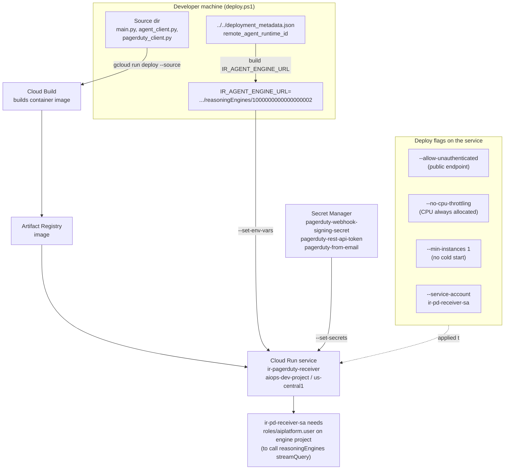
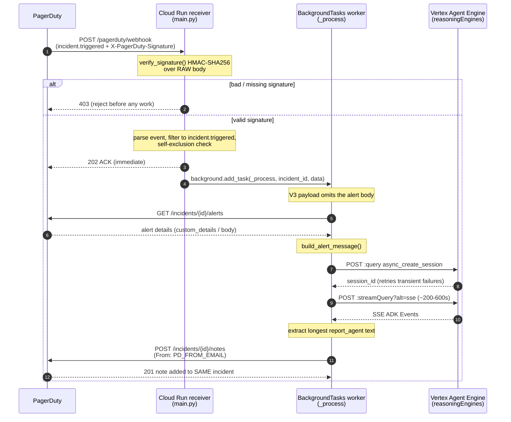

# PagerDuty Webhook Receiver — Deploy & Runtime Flow

The `ir-pagerduty-receiver` is a small FastAPI service on **Cloud Run** that turns a
PagerDuty `incident.triggered` event into an IR Agent investigation and posts the
resulting report back onto the same incident as a note.

It is a **separate deployable** from the agent itself — the agent runs on Vertex AI
Agent Engine (`reasoningEngines/1000000000000000002`); this receiver only calls it.

---

## Deploy process

`deploy.ps1` runs a single `gcloud run deploy --source` against
`aiops-dev-project / us-central1`. Cloud Build packages the source into a container,
pushes it to Artifact Registry, and Cloud Run creates/updates a public service that runs
as `ir-pd-receiver-sa`, with the engine URL as an env var and three secrets mounted from
Secret Manager.

---

## Runtime request flow

PagerDuty POSTs the event; the receiver verifies the HMAC signature, ACKs **202
immediately**, then does the long investigation off the request path in FastAPI
`BackgroundTasks`. This split is mandatory — PagerDuty requires a fast 2xx, but the
investigation takes ~200–600s.

---

## Why these flags

| Flag | Why it is required | What breaks without it |
|------|--------------------|------------------------|
| `--allow-unauthenticated` | PagerDuty webhook POSTs carry no GCP identity. The real security boundary is the `X-PagerDuty-Signature` HMAC-SHA256 check over the raw body (rejects 403 before any work). | An IAM-protected endpoint would 403 **every** delivery. |
| `--no-cpu-throttling` | The ~200–600s investigation runs in `BackgroundTasks` **after** the 202 response is sent. Always-allocated CPU keeps that work running. | Cloud Run throttles CPU to ~0 after a response, so every triage would be **silently dropped**. This is the single most important flag. |
| `--min-instances 1` | Keeps a warm instance on the webhook path. | Cold start could exceed PagerDuty's initial-ACK delivery timeout. |
| `--service-account ir-pd-receiver-sa` | Runtime identity used (via ADC) to call the Agent Engine `streamQuery`; needs `roles/aiplatform.user` on the engine project, plus read access to the mounted secrets. | Agent calls / secret reads would fail. |

---

## Safety-now nuance

The service is **public**, but `PD_WEBHOOK_SECRET` is currently a **placeholder** — the
real value only exists once the PagerDuty webhook subscription is created. Until then
every incoming webhook fails `verify_signature()` and returns **403**, so **nothing can
invoke the agent** yet. The public endpoint is inert without the real signing secret.
